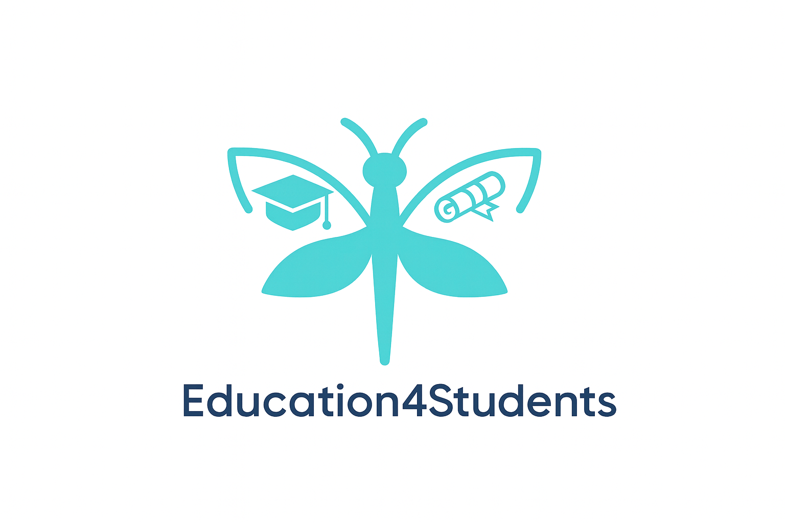
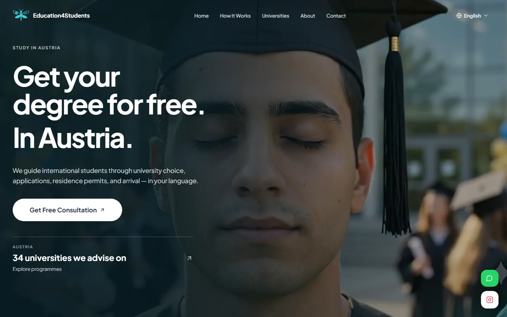
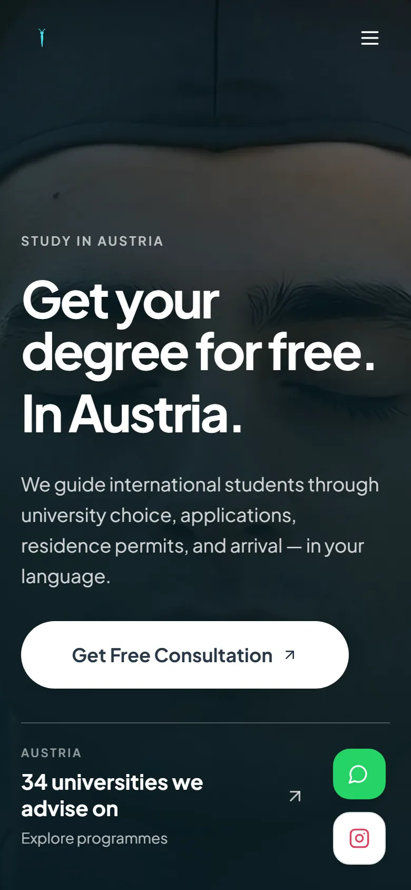
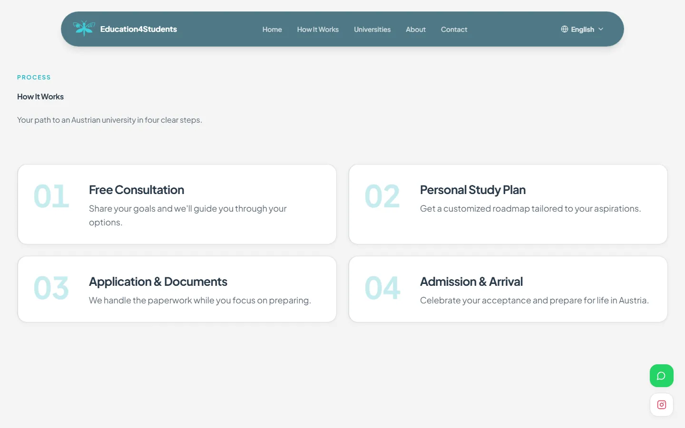
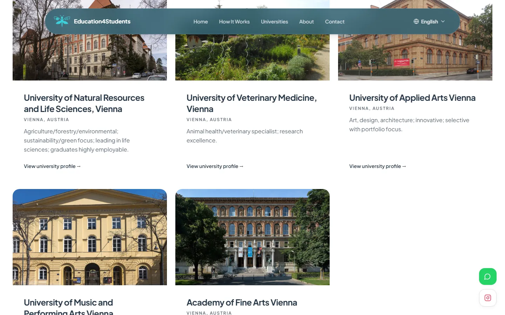
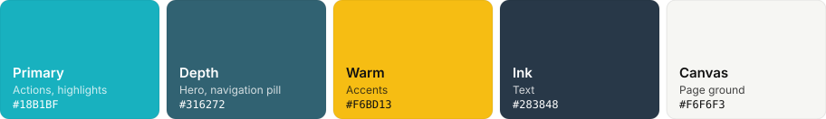
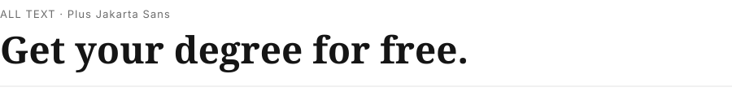

<p align="center">
  
</p>

<h1 align="center">Education4Students</h1>

<p align="center">Free guidance for students from Azerbaijan and the region who want to study in Austria: university choice, applications, residence permits and arrival.</p>

<p align="center">
  <a href="https://rustamg16.github.io/education-hub-connect/"></a>
  
  
</p>

---

## Screens

<table>
  <tr>
    <td width="74%"></td>
    <td width="26%"></td>
  </tr>
</table>

<table>
  <tr>
    <td></td>
    <td></td>
  </tr>
</table>

## Brand

**Palette**



**Typography**



| Role | Typeface | Use |
|---|---|---|
| All text | Plus Jakarta Sans | Headlines, body and interface |

**Marks.** Graduate-cap logo (`src/assets/logo.png`) with an animated Lottie version (`src/assets/loading.json`) used on phones and on hover.

**Voice.** Warm, practical and multilingual (EN, AZ, TR, RU): every step explained plainly.

Design tokens are the HSL custom properties in [`src/index.css`](src/index.css) and [`tailwind.config.ts`](tailwind.config.ts).

## Stack

| Layer | Choice |
|---|---|
| App | React 18, TypeScript, Vite 5, react-router 6 |
| UI | Tailwind 3, shadcn/ui (Radix) |
| Motion | GSAP + ScrollTrigger, Lenis smooth scroll, Lottie |

## Run locally

```bash
npm ci
npm run dev
```

`npm run build` builds to `dist/` and writes the SPA fallback for GitHub Pages.

## Deploy

Every push to `main` builds and publishes to GitHub Pages (`.github/workflows/deploy-pages.yml`).

## Structure

```
src/pages/          routes (home, about, universities)
src/components/     sections, Navbar, shadcn/ui
src/lib/scroll.ts   Lenis + ScrollTrigger setup
src/contexts/       language (EN/AZ/TR/RU)
scripts/            university data tooling
```

## Status

Live. The one real commission among these projects.

---

<sub>Designed and built by Convenium Studio, Klagenfurt. Brand assets regenerate with `templates/readme/make_readme_assets.py` from `docs/brand/brand.json`.</sub>
